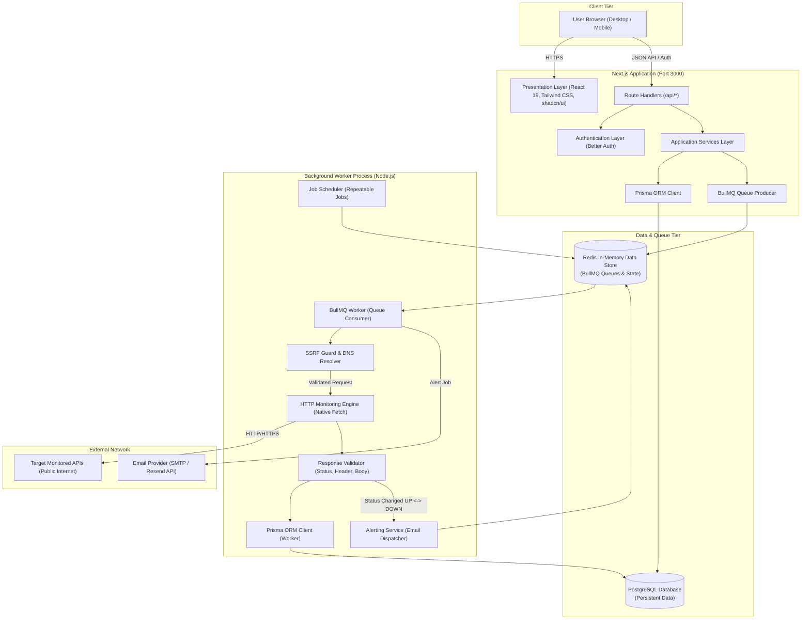
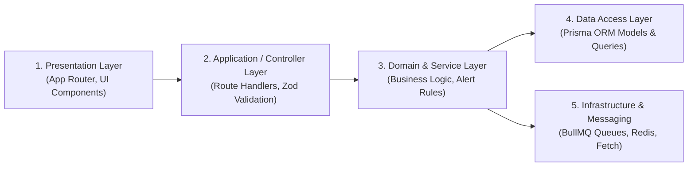
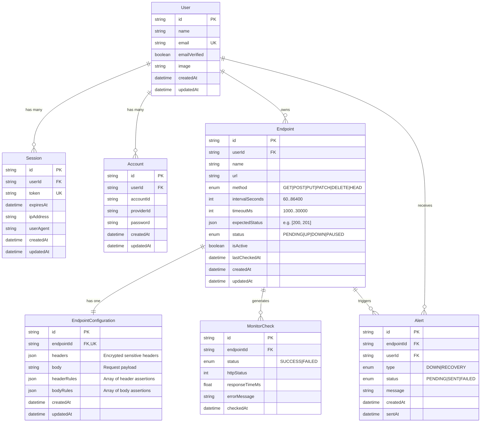
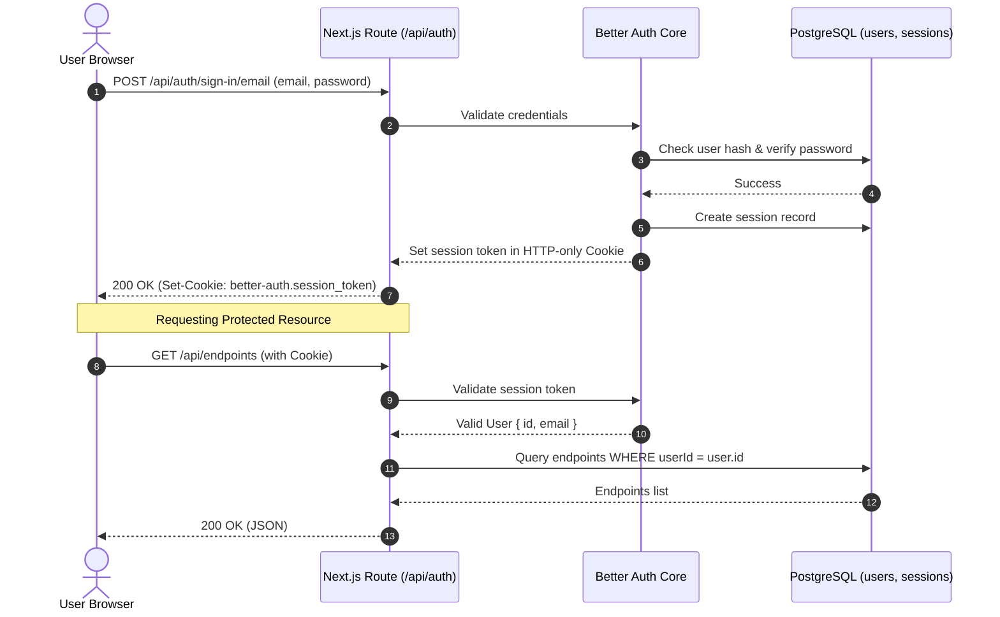
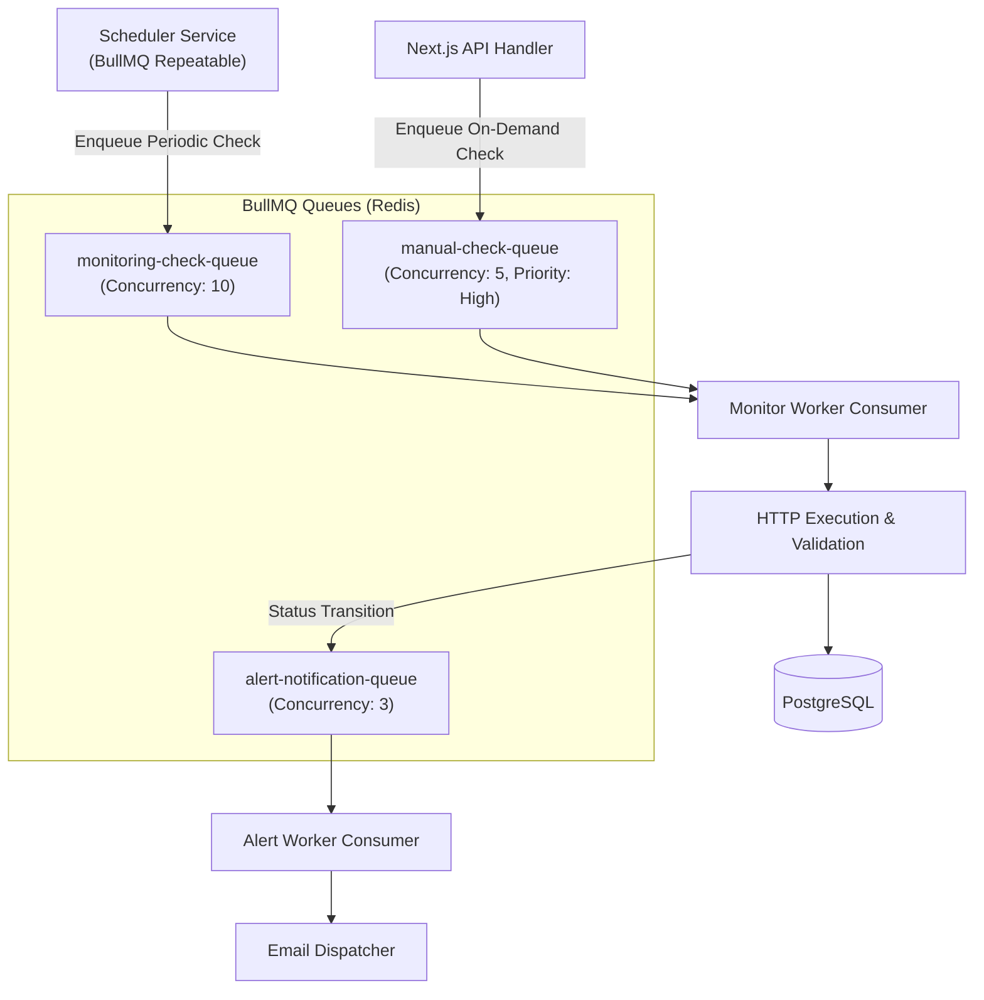
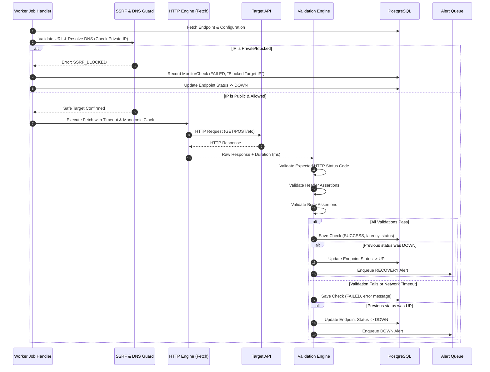
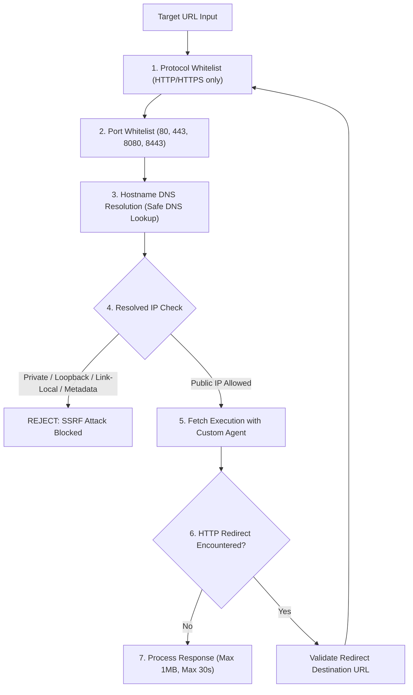
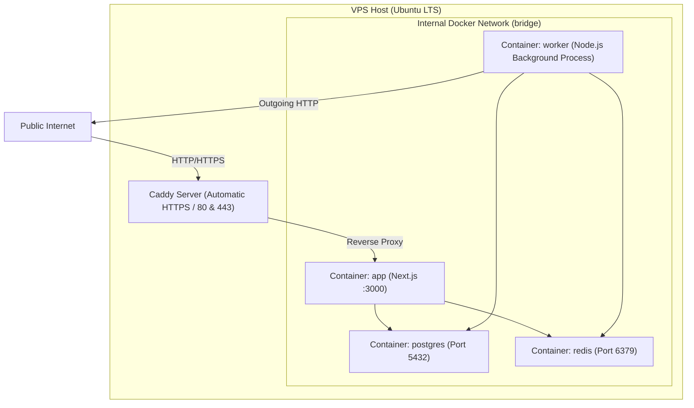

# OrderInbox — Technical Planning & Architecture Document

Dokumen ini disusun sebagai output utama dari **Phase 2 — Technical Planning & Architecture** untuk platform **OrderInbox**. Seluruh keputusan teknis, arsitektur, spesifikasi API, dan strategi keamanan dirancang selaras dengan `PRD and Playbook.md`.

---

## 1. Final System Architecture

OrderInbox mengadopsi pola **Modular Monolith + Dedicated Background Worker**. Tidak menggunakan microservices untuk MVP guna menjaga kesederhanaan operasional bagi solo developer dengan tetap mempertahankan skalabilitas dan keandalan scheduling monitoring.

### 1.1 High-Level Architecture Diagram



---

## 2. Application Architecture

Aplikasi dibagi menjadi 5 lapisan logis (layered architecture) dengan batas tanggung jawab yang tegas:



1. **Presentation Layer (`src/app`, `src/components`)**:
   - Komponen UI berbasis React Server Components (RSC) dan Client Components (`"use client"`).
   - Menggunakan Tailwind CSS v4 dan shadcn/ui.
   - Form handling dengan React Hook Form + Zod.
   - Visualisasi tren dan uptime dengan Recharts.

2. **Application Layer (`src/app/api`)**:
   - Next.js Route Handlers melayani REST API.
   - Melakukan otentikasi session via Better Auth.
   - Memvalidasi seluruh payload masuk menggunakan Zod Schema.
   - Memastikan otorisasi berbasis kepemilikan resource (Ownership check).
   - Menghasilkan format respons yang seragam.

3. **Domain / Business Logic Layer (`src/services`, `src/features`)**:
   - Mengelola lifecycle endpoint (Create, Update, Pause, Resume, Delete).
   - Sinkronisasi job scheduling ke BullMQ saat konfigurasi endpoint berubah.
   - Menghitung agregasi dashboard (total endpoint, UP, DOWN, avg latency).

4. **Data Access Layer (`src/lib/db`, `prisma/`)**:
   - Abstraksi database menggunakan Prisma ORM.
   - Koneksi singleton (`db.ts`) untuk mencegah connection leak pada Next.js dev mode.
   - Pengelolaan migrasi database secara terstruktur.

5. **Infrastructure & Worker Layer (`worker/`)**:
   - Proses Node.js standalone terpisah dari server web Next.js.
   - Eksekutor HTTP checks dengan validasi SSRF ketat.
   - Antrean background jobs dengan BullMQ dan Redis.

---

## 3. Directory & Folder Structure

Berikut adalah struktur folder final project `orderinbox`:

```text
orderinbox/
├── .env.example                     # Environment template
├── .gitignore                       # Git ignore list
├── components.json                  # shadcn/ui configuration
├── docker-compose.yml               # Production & local multi-container setup
├── next.config.ts                   # Next.js configuration
├── package.json                     # Root dependencies & scripts
├── tsconfig.json                    # Root TypeScript configuration
├── TECHNICAL_PLAN.md                # Dokumen arsitektur teknis ini
├── PRD and Playbook.md              # Dokumen master PRD
│
├── docs/                            # Dokumentasi teknis & deployment
│   ├── ARCHITECTURE.md
│   ├── API_SPEC.md
│   └── DEPLOYMENT.md
│
├── docker/                          # Dockerfiles
│   ├── Dockerfile.app               # Image container Next.js App
│   ├── Dockerfile.worker            # Image container Node.js Worker
│   └── Caddyfile                    # Reverse proxy & TLS config
│
├── prisma/                          # Database schema & migrations
│   ├── schema.prisma                # Skema data Prisma
│   └── migrations/                  # Riwayat migrasi Prisma
│
├── src/                             # Source code Next.js Web App
│   ├── app/                         # App Router
│   │   ├── (marketing)/             # Landing page & public info
│   │   │   ├── layout.tsx
│   │   │   └── page.tsx
│   │   ├── (auth)/                  # Halaman otentikasi
│   │   │   ├── login/page.tsx
│   │   │   └── register/page.tsx
│   │   ├── (dashboard)/             # Protected dashboard area
│   │   │   ├── layout.tsx
│   │   │   ├── dashboard/page.tsx
│   │   │   ├── endpoints/
│   │   │   │   ├── page.tsx
│   │   │   │   ├── new/page.tsx
│   │   │   │   └── [id]/
│   │   │   │       ├── page.tsx
│   │   │   │       └── edit/page.tsx
│   │   │   └── settings/page.tsx
│   │   └── api/                     # REST API Route Handlers
│   │       ├── auth/[...all]/route.ts
│   │       ├── dashboard/route.ts
│   │       ├── endpoints/
│   │       │   ├── route.ts
│   │       │   └── [id]/
│   │       │       ├── route.ts
│   │       │       ├── pause/route.ts
│   │       │       ├── resume/route.ts
│   │       │       ├── manual-check/route.ts
│   │       │       └── history/route.ts
│   │       └── settings/route.ts
│   │
│   ├── components/                  # Reusable UI Components
│   │   ├── ui/                      # shadcn/ui components (Button, Card, Dialog, dll)
│   │   ├── layout/                  # Navbar, Sidebar, Footer, PageContainer
│   │   ├── dashboard/               # MetricCards, StatusOverview, IncidentFeed
│   │   └── endpoints/               # EndpointForm, EndpointTable, LatencyChart
│   │
│   ├── features/                    # Feature-specific state/hooks/types
│   │   ├── auth/
│   │   ├── endpoints/
│   │   ├── monitoring/
│   │   └── alerts/
│   │
│   ├── lib/                         # Shared Utilities & Config
│   │   ├── auth/                    # Better Auth client & server initialization
│   │   │   ├── auth.ts
│   │   │   └── auth-client.ts
│   │   ├── db/                      # Prisma Client instance
│   │   │   └── prisma.ts
│   │   ├── queue/                   # BullMQ Producer connection
│   │   │   └── queues.ts
│   │   ├── validation/              # Zod schemas untuk endpoints & requests
│   │   │   └── endpoint.schema.ts
│   │   └── utils/                   # Helper functions (cn, formatters)
│   │       └── index.ts
│   │
│   ├── services/                    # Business Logic Services
│   │   ├── endpoint.service.ts
│   │   ├── dashboard.service.ts
│   │   └── user.service.ts
│   │
│   └── types/                       # Shared TypeScript Interfaces & Types
│       └── index.ts
│
├── worker/                          # Dedicated Node.js Background Worker
│   ├── package.json                 # Worker dependencies & scripts
│   ├── tsconfig.json                # Worker TypeScript config
│   └── src/
│       ├── index.ts                 # Worker entrypoint & signal handlers
│       ├── queues/                  # BullMQ Worker instances
│       │   ├── monitor.worker.ts
│       │   ├── manual.worker.ts
│       │   └── alert.worker.ts
│       ├── scheduler/               # Scheduling manager (Repeatable jobs)
│       │   └── scheduler.service.ts
│       ├── engine/                  # Core HTTP check runner
│       │   ├── http-executor.ts     # Native fetch wrapper + timer
│       │   ├── validator.ts         # Status, header & body validation
│       │   └── result-persister.ts  # Save check result & update status
│       ├── security/                # SSRF Protection
│       │   ├── ip-validator.ts      # Private/reserved IP check
│       │   ├── dns-resolver.ts      # Safe DNS lookup
│       │   └── url-sanitizer.ts     # URL parsing & protocol check
│       └── services/                # Notification & alert dispatch
│           └── email.service.ts
│
└── tests/                           # Unit, Integration & E2E Tests
    ├── unit/
    ├── integration/
    └── e2e/
```

---

## 4. Database ERD & Prisma Model Planning

### 4.1 Entity Relationship Diagram



### 4.2 Skema Prisma Terencana (`prisma/schema.prisma`)

```prisma
datasource db {
  provider = "postgresql"
  url      = env("DATABASE_URL")
}

generator client {
  provider = "prisma-client-js"
}

enum HttpMethod {
  GET
  POST
  PUT
  PATCH
  DELETE
  HEAD
}

enum MonitorStatus {
  PENDING
  UP
  DOWN
  PAUSED
}

enum CheckResultStatus {
  SUCCESS
  FAILED
}

enum AlertType {
  DOWN
  RECOVERY
}

enum AlertStatus {
  PENDING
  SENT
  FAILED
}

// Model Otentikasi (Sesuai spesifikasi Better Auth)
model User {
  id            String     @id @default(cuid())
  name          String
  email         String     @unique
  emailVerified Boolean    @default(false)
  image         String?
  createdAt     DateTime   @default(now())
  updatedAt     DateTime   @updatedAt

  sessions      Session[]
  accounts      Account[]
  endpoints     Endpoint[]
  alerts        Alert[]

  @@map("users")
}

model Session {
  id        String   @id @default(cuid())
  userId    String
  user      User     @relation(fields: [userId], references: [id], onDelete: Cascade)
  token     String   @unique
  expiresAt DateTime
  ipAddress String?
  userAgent String?
  createdAt DateTime @default(now())
  updatedAt DateTime @updatedAt

  @@index([userId])
  @@map("sessions")
}

model Account {
  id         String    @id @default(cuid())
  userId     String
  user       User      @relation(fields: [userId], references: [id], onDelete: Cascade)
  accountId  String
  providerId String
  password   String?
  createdAt  DateTime  @default(now())
  updatedAt  DateTime  @updatedAt

  @@index([userId])
  @@map("accounts")
}

model Verification {
  id         String    @id @default(cuid())
  identifier String
  value      String
  expiresAt  DateTime
  createdAt  DateTime  @default(now())
  updatedAt  DateTime  @updatedAt

  @@map("verifications")
}

// Model Inti Monitoring
model Endpoint {
  id              String        @id @default(cuid())
  userId          String
  user            User          @relation(fields: [userId], references: [id], onDelete: Cascade)
  name            String
  url             String
  method          HttpMethod    @default(GET)
  intervalSeconds Int           @default(60)
  timeoutMs       Int           @default(10000)
  expectedStatus  Int[]         @default([200])
  status          MonitorStatus @default(PENDING)
  isActive        Boolean       @default(true)
  lastCheckedAt   DateTime?
  createdAt       DateTime      @default(now())
  updatedAt       DateTime      @updatedAt

  configuration   EndpointConfiguration?
  checks          MonitorCheck[]
  alerts          Alert[]

  @@index([userId])
  @@index([status])
  @@index([isActive])
  @@map("endpoints")
}

model EndpointConfiguration {
  id          String   @id @default(cuid())
  endpointId  String   @unique
  endpoint    Endpoint @relation(fields: [endpointId], references: [id], onDelete: Cascade)
  headers     Json?    // Menyimpan key-value request headers
  body        String?  // Request body (JSON/text)
  headerRules Json?    // Rule validasi response header
  bodyRules   Json?    // Rule validasi response body
  createdAt   DateTime @default(now())
  updatedAt   DateTime @updatedAt

  @@map("endpoint_configurations")
}

model MonitorCheck {
  id             String            @id @default(cuid())
  endpointId     String
  endpoint       Endpoint          @relation(fields: [endpointId], references: [id], onDelete: Cascade)
  status         CheckResultStatus
  httpStatus     Int?
  responseTimeMs Float?
  errorMessage   String?
  checkedAt      DateTime          @default(now())

  // Composite index untuk efisiensi query riwayat & agregasi
  @@index([endpointId, checkedAt(sort: Desc)])
  @@index([checkedAt])
  @@map("monitor_checks")
}

model Alert {
  id         String      @id @default(cuid())
  endpointId String
  endpoint   Endpoint    @relation(fields: [endpointId], references: [id], onDelete: Cascade)
  userId     String
  user       User        @relation(fields: [userId], references: [id], onDelete: Cascade)
  type       AlertType
  status     AlertStatus @default(PENDING)
  message    String?
  createdAt  DateTime    @default(now())
  sentAt     DateTime?

  @@index([userId, createdAt(sort: Desc)])
  @@index([endpointId])
  @@map("alerts")
}
```

### 4.3 Strategi Indexing & Data Retention
1. **Indexing**:
   - `endpoints(userId)`: Query daftar endpoint milik user.
   - `endpoints(status, isActive)`: Query scheduler mencari endpoint aktif.
   - `monitor_checks(endpointId, checkedAt DESC)`: Query grafik latency dan riwayat terbaru per endpoint.
   - `alerts(userId, createdAt DESC)`: Query notifikasi insiden di dashboard user.
2. **Data Retention Policy**:
   - `monitor_checks`: Data log pemeriksaan disimpan selama 30 hari. Scheduler cron worker akan membersihkan data lama secara berkala melalui query `DELETE WHERE checkedAt < NOW() - INTERVAL '30 days'`.
   - `alerts`: Data alert disimpan selama 90 hari.

---

## 5. API Endpoint Specifications

Semua endpoint API menggunakan format respon standar JSON.

### 5.1 Standar Format Respons
- **Sukses**:
  ```json
  {
    "success": true,
    "data": { ... }
  }
  ```
- **Error**:
  ```json
  {
    "success": false,
    "error": {
      "code": "BAD_REQUEST",
      "message": "Deskripsi pesan kesalahan yang jelas",
      "details": [ ... ]
    }
  }
  ```

### 5.2 Daftar Endpoint REST API

| Method | Path | Auth | Deskripsi |
| :--- | :--- | :---: | :--- |
| `POST` | `/api/auth/*` | Bebas/Session | Otentikasi (Better Auth handler) |
| `GET` | `/api/dashboard` | Wajib | Ringkasan statistik monitoring & status |
| `GET` | `/api/endpoints` | Wajib | Mengambil semua endpoint milik pengguna aktif |
| `POST` | `/api/endpoints` | Wajib | Membuat endpoint baru & mendaftarkan ke scheduler |
| `GET` | `/api/endpoints/[id]` | Wajib | Mengambil detail endpoint beserta konfigurasinya |
| `PUT` | `/api/endpoints/[id]` | Wajib | Memperbarui konfigurasi endpoint & jadwal |
| `DELETE`| `/api/endpoints/[id]` | Wajib | Menghapus endpoint & membatalkan repeatable job |
| `POST` | `/api/endpoints/[id]/pause` | Wajib | Menonaktifkan sementara pemeriksaan |
| `POST` | `/api/endpoints/[id]/resume` | Wajib | Mengaktifkan kembali pemeriksaan |
| `POST` | `/api/endpoints/[id]/manual-check` | Wajib | Memicu on-demand check ke queue |
| `GET` | `/api/endpoints/[id]/history` | Wajib | Riwayat check dengan pagination |
| `GET` | `/api/settings` | Wajib | Konfigurasi profil & notifikasi pengguna |
| `PUT` | `/api/settings` | Wajib | Memperbarui profil atau preferensi email |

### 5.3 Contoh Spesifikasi Request & Response

#### A. `POST /api/endpoints`
- **Request Body**:
  ```json
  {
    "name": "Production Payment Gateway",
    "url": "https://api.example.com/health",
    "method": "GET",
    "intervalSeconds": 60,
    "timeoutMs": 5000,
    "expectedStatus": [200],
    "headers": {
      "Authorization": "Bearer secret-token",
      "Accept": "application/json"
    },
    "body": null,
    "headerRules": [
      {
        "header": "content-type",
        "operator": "CONTAINS",
        "value": "application/json"
      }
    ],
    "bodyRules": [
      {
        "type": "JSON_PROPERTY_EQUALS",
        "path": "status",
        "value": "healthy"
      }
    ]
  }
  ```
- **Response 201 Created**:
  ```json
  {
    "success": true,
    "data": {
      "id": "cuid12345",
      "name": "Production Payment Gateway",
      "url": "https://api.example.com/health",
      "method": "GET",
      "intervalSeconds": 60,
      "timeoutMs": 5000,
      "status": "PENDING",
      "isActive": true,
      "createdAt": "2026-11-17T00:00:00.000Z"
    }
  }
  ```

#### B. `GET /api/dashboard`
- **Response 200 OK**:
  ```json
  {
    "success": true,
    "data": {
      "summary": {
        "totalEndpoints": 8,
        "activeEndpoints": 7,
        "upEndpoints": 6,
        "downEndpoints": 1,
        "pausedEndpoints": 1,
        "avgResponseTimeMs": 142.5
      },
      "recentIncidents": [
        {
          "endpointId": "cuid12345",
          "endpointName": "Production Payment Gateway",
          "type": "DOWN",
          "reason": "HTTP status 503 (Expected: [200])",
          "timestamp": "2026-11-16T23:55:00.000Z"
        }
      ]
    }
  }
  ```

---

## 6. Authentication Architecture

Otentikasi ditangani oleh **Better Auth** menggunakan PostgreSQL adapter.



1. **Session Management**:
   - HTTP-only, secure, `SameSite=Lax` cookie.
   - Session disimpan di PostgreSQL dengan auto-expiry.
2. **Server-Side Protection**:
   - Helper `auth.api.getSession({ headers })` memeriksa session pada Route Handlers dan Server Components.
   - Resource access selalu memverifikasi `WHERE userId = session.user.id`.

---

## 7. Worker Architecture & BullMQ Queue Design

Worker adalah aplikasi Node.js mandiri (`worker/src/index.ts`) yang berjalan terus-menerus di background (tidak terikat siklus serverless Next.js).

### 7.1 Queue Architecture



### 7.2 Spesifikasi Antrean (Queues)
1. **`monitoring-check-queue`**:
   - Menangani pekerjaan rutin terjadwal.
   - Concurrency default: 10 worker threads/tasks.
   - Retry: 0 (pemeriksaan monitoring yang gagal tidak di-retry agar tidak merusak interval dan response time). Kegagalan langsung dicatat sebagai status `DOWN`.
2. **`manual-check-queue`**:
   - Menangani tombol "Check Now" dari dashboard pengguna.
   - Prioritas tinggi.
   - Rate limit per user: maksimal 1 request per 10 detik per endpoint.
3. **`alert-notification-queue`**:
   - Menangani pengiriman email notifikasi.
   - Retry: 3 kali dengan Exponential Backoff (10s, 30s, 60s).

### 7.3 Lifecycle & Graceful Shutdown
Worker menangani sinyal OS `SIGTERM` dan `SIGINT`:
```typescript
async function shutdown() {
  console.log("Shutting down worker gracefully...");
  await monitorWorker.close();
  await alertWorker.close();
  await prisma.$disconnect();
  await redis.quit();
  process.exit(0);
}
process.on("SIGTERM", shutdown);
process.on("SIGINT", shutdown);
```

---

## 8. Monitoring Scheduler & Engine

### 8.1 Strategi Scheduling (BullMQ Repeatable Jobs)
- Setiap endpoint yang berstatus `isActive: true` memiliki 1 repeatable job di BullMQ dengan ID `endpoint:{id}`.
- Pola interval menggunakan millisecond repetition: `{ every: intervalSeconds * 1000 }`.
- **Idempotency**:
  - Saat endpoint dibuat: `queue.add("check", { endpointId }, { jobId: "endpoint:" + id, repeat: { every: interval } })`.
  - Saat endpoint diubah: hapus repeatable job lama berdasarkan key ID, lalu daftarkan yang baru.
  - Saat endpoint di-pause/delete: hapus repeatable job dari Redis. Hal ini menjamin tidak ada duplicate scheduled job.

### 8.2 Execution Pipeline



### 8.3 Response Time Measurement
- Menggunakan monotonic clock: `performance.now()`.
- Waktu diukur tepat sebelum pemanggilan socket request dimulai hingga chunk pertama dari response body selesai dibaca.
- Angka yang disimpan bertipe `Float` dalam satuan milliseconds (ms).

### 8.4 Aturan Validasi (Validation Engine)
1. **HTTP Status**: Memeriksa apakah `actualStatus` termasuk dalam array `expectedStatus` (misal `[200, 201]`).
2. **Header Rules**:
   - Case-insensitive matching pada header name.
   - Operator: `CONTAINS`, `EQUALS`, `EXISTS`.
3. **Body Rules**:
   - Response body dibatasi maksimal **1 MB** untuk mencegah buffer overflow / memory exhaustion.
   - Rule Types:
     - `CONTAINS_TEXT`: Memeriksa teks tertentu dalam response body.
     - `NOT_CONTAINS_TEXT`: Memastikan teks error tertentu tidak muncul.
     - `JSON_PROPERTY_EXISTS`: Melakukan JSON parse dan mengecek keberadaan key (misal `data.status`).
     - `JSON_PROPERTY_EQUALS`: Memeriksa kecocokan value field JSON.

---

## 9. SSRF Protection Strategy (Keamanan Kritis)

Monitoring engine mengizinkan pengguna menentukan target URL sendiri. Ini menghadirkan ancaman **Server-Side Request Forgery (SSRF)** terhadap jaringan internal VPC/server lokal.

### 9.1 Threat Model
- Akses ke `localhost` (127.0.0.1, ::1).
- Akses ke private subnets:
  - `10.0.0.0/8`
  - `172.16.0.0/12`
  - `192.168.0.0/16`
- Akses ke link-local / API metadata cloud:
  - `169.254.169.254` (AWS, GCP, DigitalOcean instance metadata).
  - `169.254.0.0/16`
- Akses ke IPv6 private/unique local: `fc00::/7`, `fe80::/10`.
- Serangan **DNS Rebinding**: Hostname awal lolos validasi IP publik, namun saat fetch dilakukan TTL DNS habis dan meresolusi ke IP privat.
- **Open Redirect**: URL awal adalah server publik valid, namun server tersebut me-redirect (HTTP 301/302) ke IP internal.

### 9.2 Arsitektur Pertahanan Berlapis (Defense in Depth)



### 9.3 Implementasi Teknis SSRF Guard
1. **Pre-flight DNS Check**:
   Resolusi hostname menggunakan `dns.promises.lookup` dengan flag `all: true`. Setiap IP hasil lookup dicek terhadap daftar CIDR terlarang.
2. **Custom HTTP Dispatcher / Lookup**:
   Gunakan HTTP Agent kustom atau undici dispatcher yang mengikat koneksi TCP langsung ke resolved IP yang telah tervalidasi publik guna mencegah DNS Rebinding.
3. **Redirect Control**:
   - `redirect: 'manual'`.
   - Mengikuti redirect maksimal 3 hop secara manual. Setiap hop URL redirect harus melalui siklus validasi protokol dan IP yang sama sebelum dieksekusi.
4. **Timeouts & Limits**:
   - Default timeout: 10 detik (`AbortSignal.timeout(10000)`).
   - Maksimum timeout yang diizinkan pengguna: 30 detik.
   - Maksimum response body: 1 Megabyte (`response.body.getReader()` dengan pemotongan ukuran).

---

## 10. Error Handling & Structured Logging

### 10.1 Penanganan Error
- **Error API**: Seluruh Route Handler dibungkus dalam error handler terpusat yang memetakan error Zod, Prisma, atau Autentikasi ke format respon `{ success: false, error: { code, message } }`.
- **Error Monitoring**: Worker membedakan antara:
  - *Network Error* (DNS lookup failed, Connection refused, Timeout).
  - *Validation Error* (HTTP status 500, JSON schema mismatch).
  - Status keduanya menghasilkan check `FAILED`, namun deskripsi error disimpan secara akurat di `errorMessage` untuk kebutuhan troubleshooting user.

### 10.2 Logging Strategy
- Menggunakan structured JSON logging (misal `pino` atau standar console JSON).
- Setiap log mencantumkan `timestamp`, `level` (`info`, `warn`, `error`), `context` (`worker` atau `api`), dan `traceId`/`jobId`.
- **Penyaringan Data Sensitif (Sanitization)**:
  - Nilai header `Authorization`, `Cookie`, `X-Api-Key` disamarkan (`[REDACTED]`).
  - Kata sandi user tidak pernah dicatat dalam log.

---

## 11. Environment Variables Reference

| Variable | Required | Default | Deskripsi |
| :--- | :---: | :--- | :--- |
| `NODE_ENV` | Ya | `development` | Environment runtime (`development` / `production`) |
| `APP_URL` | Ya | `http://localhost:3000` | URL publik aplikasi web |
| `DATABASE_URL` | Ya | - | PostgreSQL connection string |
| `REDIS_URL` | Ya | `redis://localhost:6379` | Redis connection string untuk BullMQ |
| `BETTER_AUTH_SECRET` | Ya | - | Random 32+ character string untuk enkripsi token session |
| `BETTER_AUTH_URL` | Ya | `http://localhost:3000` | Base URL untuk Better Auth callback |
| `EMAIL_PROVIDER_API_KEY`| Opsional | - | API key provider email (misal Resend / SendGrid) |
| `EMAIL_FROM` | Opsional | `notifications@orderinbox.local` | Alamat pengirim email notifikasi |

---

## 12. Deployment Architecture (VPS + Docker Compose)

Untuk tahap MVP dan produksi awal, seluruh sistem dijalankan di atas single VPS (minimum 2 vCPU, 2 GB RAM) menggunakan Docker Compose.



### 12.1 Layanan Docker Compose (`docker-compose.yml`)
1. **`caddy`**: Reverse proxy otomatis menangani SSL/TLS Let's Encrypt dan mengarahkan lalu lintas ke container `app`.
2. **`app`**: Web service Next.js App Router (Production build).
3. **`worker`**: Node.js worker process yang menjalankan BullMQ scheduler dan worker. Menggunakan image yang sama atau Dockerfile worker mandiri.
4. **`postgres`**: Database PostgreSQL dengan Docker persistent volume (`pgdata`).
5. **`redis`**: In-memory message broker BullMQ dengan volume persistence (`redisdata`).

---

## 13. Dependency Decisions & Rationales

| Package | Tujuan | Alasan Pemilihan & Alternatif Ditolak |
| :--- | :--- | :--- |
| `next` (v16+) | Framework Fullstack | Standar industri React, SSR, App Router, Route Handlers terintegrasi |
| `prisma` | ORM | Type-safe query builder, migrasi skema deklaratif, mendukung PostgreSQL |
| `better-auth` | Autentikasi | Ringan, mendukung App Router modern, tidak terkunci vendor SaaS |
| `bullmq` + `ioredis` | Queue & Job Scheduler | Manajemen background worker andal, mendukung repeatable jobs & retry |
| `zod` | Skema Validasi | Validasi runtime type-safe baik di API endpoint maupun konfigurasi monitoring |
| `react-hook-form` | Form Management | Performa tinggi, kontrol validasi form kompleks tanpa re-render berlebih |
| `tailwindcss` + `shadcn/ui`| Design System & UI | Cepat, konsisten, komponen accessible tanpa runtime CSS berat |
| `recharts` | Grafik Visualisasi | Representasi visual latency & uptime monitoring yang modular |
| `pino` (worker) | Structured Logger | Logging performa tinggi dengan output JSON terstruktur |

> **Prinsip**: Tidak ada Axios (digantikan Native Fetch), tidak ada GraphQL (REST API sederhana sudah sangat optimal), dan tidak ada microservices overhead.

---

## 14. Technical Risk Assessment & Mitigation

| Risiko Teknis | Dampak | Strategi Mitigasi |
| :--- | :--- | :--- |
| **SSRF (Internal Network Probe)** | Kritis: Pembobolan layanan cloud internal/database | Strict DNS validation, IP blacklist (RFC1918 & metadata), redirect check, egress firewall |
| **Duplicate Scheduler Jobs** | Tinggi: Target API dibanjiri request berlebih | Idempotent job ID (`endpoint:{id}`), cleanup repeatable job sebelum add/update |
| **Worker Process Crash** | Tinggi: Monitoring terhenti | Docker container auto-restart (`restart: unless-stopped`), process supervisor |
| **Database Storage Exhaustion** | Sedang: Query melambat dan disk habis | Data retention policy 30 hari untuk `monitor_checks`, index composite |
| **Email Alert Spamming** | Sedang: User terganggu & kuota email habis | Status flapping protection: Notifikasi hanya dikirim saat status berubah (`UP` ↔ `DOWN`) |
| **Slow/Hanging Target API** | Sedang: Worker starvation | AbortSignal strict timeout (default 10s, max 30s) |

---

## 15. Kesimpulan & Status Phase 2

Perencanaan arsitektur teknis telah lengkap dan mendalam, mencakup seluruh 18 poin yang disyaratkan dalam PRD. Seluruh keputusan konsisten dengan batasan solo developer MVP.

Dokumen ini menjadi acuan mutlak untuk pengerjaan **Phase 3 (UI/UX Planning & Design System)** dan implementasi selanjutnya.
